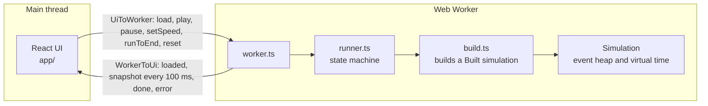
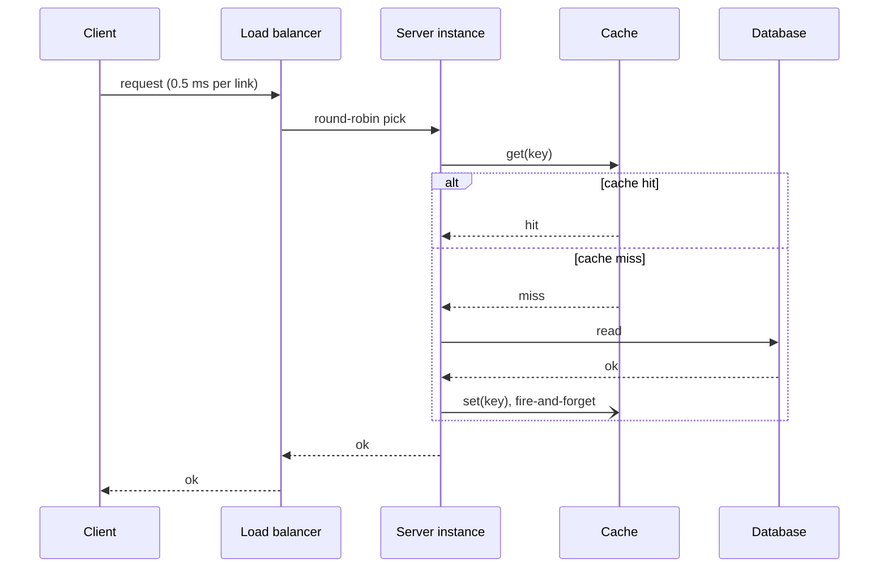

# Architecture (M1)

How the simulator and the app are put together, as built in M1 (commit `c0787c5`). This describes what the code does today. For the build plan and the reasoning behind it, see [`m1_spec.md`](../m1_spec.md) and [`decisions.md`](decisions.md).

**Last updated:** 2026-11-24

## 1. What it does

You place components (client, load balancer, server, cache, database) on a canvas and connect them. The simulator sends traffic through your design in **virtual time**, tracks **every request individually**, and reports latency, errors, utilization and cost. After the run an evaluator tells you whether the design met the goals and gives a hint if it did not.

The only scenario in M1 is **Scale a read-heavy app**. A second one, a variant, exists for the prediction exercise.

## 2. Big picture

The simulation runs in a **Web Worker**, so the UI stays responsive. The two sides talk through a small message protocol.

### Code map

| Folder | Contents |
|---|---|
| `engine/core/` | The simulation kernel: `types.ts`, `heap.ts` (event queue), `rng.ts` (seeded random numbers), `zipf.ts` (skewed key sampling), `sim.ts` (virtual-time loop) |
| `engine/components/` | One file per component: `instance.ts` (worker pool and queue, shared by all), `client.ts`, `loadBalancer.ts`, `server.ts`, `cache.ts`, `database.ts` |
| `engine/` | `catalog.ts` (sizes and prices), `validate.ts`, `build.ts` (wires a design into a simulation), `metrics.ts`, `evaluator.ts`, `runner.ts`, `protocol.ts`, `worker.ts` |
| `scenarios/` | `readHeavy.ts` (scenario, starter and reference designs), `readHeavyVariant.ts` |
| `app/` | `state.ts` (reducer), `useSimWorker.ts` (talks to the worker), `canvas/` (React Flow), `panels/` (Palette, Inspector, Controls, Dashboard, EvaluationPanel) |
| `tests/` | `engine/` (unit), `fidelity/` (accuracy and scenarios), `bench/` (speed), `fixtures.ts` |

## 3. How a request flows

- **Links** add a constant 0.5 ms each way. They have no faults in M1.
- **Writes** go to the database, then **invalidate** the cache entry (fire-and-forget).
- If the database call fails, the server returns a `downstream` error.
- A request is a single object `{id, kind, key, op, size, createdAt, deadline}`. The client assigns the deadline as `createdAt + timeout`.

## 4. Key mechanics

### 4.1 Virtual time and the event loop
- Time is measured in **virtual milliseconds**. Nothing sleeps; the simulation jumps from event to event.
- `Simulation.runUntil(t, wallBudgetMs)` pops events in order of `(time, sequence number)` and runs them. It checks the wall clock every 1,000 events and stops early if the budget is spent. That is how playback slows down instead of freezing the page.
- **Determinism:** all randomness comes from one seeded generator (`mulberry32`). The same seed and design always produce a byte-identical event trace. A test checks this.

### 4.2 Worker pools and queues (`Instance`)
Every component except the client is made of instances. Each instance has a number of workers (concurrency), a bounded FIFO queue, and a service time drawn from an exponential distribution (the load balancer uses a fixed time).

| Step | What happens |
|---|---|
| Arrives | A free worker takes it. Otherwise it joins the queue. If the queue is full it is **rejected**. |
| Starts | If its deadline has already passed, it is **dropped** with a timeout and no service time is spent. |
| Finishes | The worker is freed and the next queued request starts. |

**A worker stays held while it waits on downstream calls**, like a thread-per-request server. This is what makes a slow database back up into the servers in front of it. It is the main teaching mechanism of the simulator.

### 4.3 Two utilization numbers
Each instance tracks two time integrals, flushed every time its state changes:

| Metric | Meaning | Shown on the canvas as |
|---|---|---|
| `heldUtil` | Share of workers that are held, including workers just waiting on downstreams | "workers in use" |
| `serviceUtil` | Share of workers doing the component's **own** work | "own work" |

Both numbers matter because a saturated database makes every server in front of it show about 100% `heldUtil`, while the servers' `serviceUtil` stays low.

### 4.4 Traffic generation
The client produces a non-homogeneous Poisson process by **thinning**: it draws candidate arrivals at the peak rate and accepts each with probability `rate(t) / peak`. The rate ramps linearly within each phase of the scenario. Keys follow a Zipf distribution, so a few keys are very popular.

### 4.5 Cache
`LruTtlStore` is a JS `Map` in insertion order (the LRU order). Entries have a time-to-live. A `get` refreshes the LRU position. `set` evicts the oldest entry when over capacity.

### 4.6 End of a run
A run ends at `durationSec + timeout`. Any request still outstanding then is recorded as a timeout. A reply that arrives after its deadline is also counted as a timeout, so stopping at that moment loses nothing.

## 5. Metrics and evaluation

**Metrics.** A sampler runs every virtual second and closes one **bucket**: requests created, ok completions, errors by kind, p50 and p99 latency (nearest-rank), and per-node `heldUtil`, `serviceUtil`, queue length, rejections and cache hits and misses. Per-request records go into growable typed arrays for the evaluator.

**Evaluator.** It looks only at the scenario's window (60 to 180 s in the main scenario).

| Criterion | Passes when |
|---|---|
| p99 latency | below the limit |
| Error rate | below the limit |
| Cost | within the budget |

**Bottleneck rule.**
1. Take the nodes whose window-mean `heldUtil` is **at least 0.9**. If there are any, the bottleneck is the one **furthest downstream** (order: database, cache, server, load balancer). This finds the node that is full while its own downstream is not.
2. Otherwise it is the node with the highest `serviceUtil`.

The evaluator also names the **rejecting node** (most rejected plus dropped requests) and picks a hint from the scenario's rules.

## 6. Runner and protocol

`runner.ts` drives the simulation in wall-clock time and is the only code that talks to the UI.

| State | Meaning |
|---|---|
| `idle` | Nothing loaded |
| `loaded` | Design validated and built |
| `playing` | Ticks every 16 ms, giving the engine 12 ms per tick |
| `fast` | "Run to end": 50 ms chunks, yielding between them so pause and reset still work |
| `paused` | Stopped, can resume |
| `done` | Finished, evaluation posted |

- Every message carries a **`runId`**. The UI ignores messages from older runs, so nothing stale appears after a reset.
- Every 100 ms the runner posts a **snapshot** with new buckets and animation hops.
- A **lagging** flag is set when at least 30 of the last 60 ticks fell short of their target. The UI then shows "Simulation slowed: engine at capacity".
- **Animation:** only 1 in N requests is sampled (N scales with load and speed, about 50 animated requests per wall-second). Sampling never touches the random generator, so it cannot change results.

## 7. Catalog (sizes and prices)

Service means are in virtual milliseconds. Prices are per instance per hour.

| Component | Tier | Workers | Queue | Service mean | Capacity | Price |
|---|---|---|---|---|---|---|
| Load balancer | — | 20,000 | 0 | 0.05 (fixed) | — | $0.05 |
| Server | small | 16 | 64 | 2.0 | — | $0.10 |
| Server | medium | 32 | 128 | 2.0 | — | $0.20 |
| Cache | small | 64 | 256 | 0.2 | 10,000 keys | $0.05 |
| Cache | medium | 64 | 256 | 0.2 | 50,000 keys | $0.15 |
| Cache | large | 64 | 256 | 0.2 | 100,000 keys | $0.40 |
| Database | medium | 32 | 256 | read 10, write 20 | — | $0.50 |
| Database | large | 64 | 256 | read 10, write 20 | — | $1.00 |
| Database | xlarge | 128 | 256 | read 10, write 20 | — | $2.50 |

## 8. The M1 scenario

**Scale a read-heavy app:** traffic ramps from 1,000 to 10,000 requests/s over 60 s, then holds for 120 s. 90% reads, Zipf 1.0 over 100,000 keys, 1 s client timeout. **Goal:** p99 under 200 ms, errors under 0.1%, cost at most $2.50/h, measured from 60 s to 180 s.

| Design | Cost | Result |
|---|---|---|
| **Starter:** client → 1 small server → medium database | $0.60/h | Fails. About 88% errors. The server's worker pool runs out, so the bottleneck is `server-1`. |
| **Reference:** client → load balancer → 8 small servers → medium cache (TTL 60 s) + large database | $2.00/h | Passes. p99 about 54 ms, no errors. The bottleneck is the database at about 61% own work. |

## 9. Testing and performance

| Suite | Command | What it checks | Result (2026-11-24) |
|---|---|---|---|
| Unit | `npm test` | Heap, RNG, Zipf, components, metrics, validation, evaluator, determinism, runner | 53 pass |
| Fidelity | `npm run test:fidelity` | M/M/1 queue against theory; the scenario's starter, reference, guard and no-cache designs | 9 pass |
| Benchmark | `npm run bench` | Engine speed on the reference run | 549k events/s (floor 200k) |

- **Accuracy:** at 90% load a simulated single-server queue gives a mean wait of 9.76 ms against the textbook 10.0, and p99 of 45.4 ms against 46.05.
- **Cost of a request:** about 11 simulated events. Real-time playback at 10k requests/s therefore needs about 110k events/s. In the browser the engine measured 96k to 133k events/s while holding exactly 1× speed with no lag.
- **FPS:** not yet measured in real Chrome (the built-in browser pane throttles rendering when hidden). Pending in the M1 gate.

## 10. Known limitations (M1)

- Exactly one server node (scale it with its instance count); one cache and one database.
- No failure injection, only round-robin load balancing, no CDN. These arrive in M2.
- The dashboard updates once per virtual second.
- A timeout shows on the dashboard in the second its late reply arrives, not the second it expired. The evaluator is unaffected, because it groups by creation time.
- The dev tooling (Vitest 3) has known audit advisories. They affect only the local test runner.

## 11. Working with the code

**Run it:** see the [index](README.md#quick-reference).

**Add a scenario:**
1. Create a `Scenario` object in `scenarios/` with traffic, mix, budget, criteria, hints, and starter and reference designs.
2. Add it to the `SCENARIOS` list in `app/App.tsx`.
3. Add fidelity tests: the reference passes, the starter fails, the bottleneck is what you expect.
4. Tune the **reference design** or the numbers, never the engine or the catalog, to make a scenario behave. See [`m1_spec.md`](../m1_spec.md) §11, Phase 3.

**Pitfalls found while building:**
- **Long test runs:** runs longer than about 50 s must yield to the event loop, or Vitest's worker times out with an "unhandled error". Use `runToEndYielding` from `tests/fixtures.ts`.
- **React Flow v12:** keep nodes in local state and apply changes with `applyNodeChanges`. If its own measurements are dropped, nodes stay hidden. Fit the view only after every node is measured.
- **Deviations from the spec** are recorded in [`m1_spec.md`](../m1_spec.md) §15.
